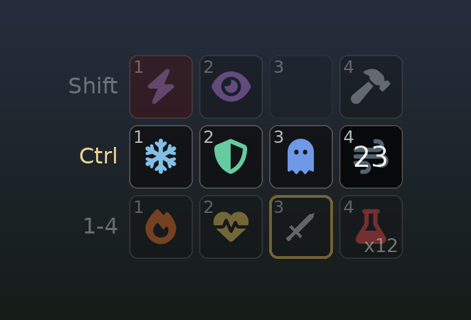

# Spell Chords

**12 extra favorites hotkeys** on **Ctrl / Shift / Alt + 1-4**, and an optional **MMO-style spell bar** on the HUD that
shows what every hotkey does. The vanilla hotkeys 1-8 keep working as before.



(The picture is a mock-up drawn with the bar's layout rules, not an in-game screenshot.)

## What it does

A chord works exactly like a vanilla hotkey: the game's own favorites code equips or uses the item, so one-handed weapons,
spells, shields, torches, potions, scrolls, powers and shouts behave the same way. A spell goes to the left hand and
pressing again fills the other hand, a potion is drunk, and so on.

- **Assign:** open the Favorites menu (Q), highlight an entry and press the chord, for example **Ctrl+1**. A notice confirms
  it. The same chord on the same entry clears the slot. The entry's vanilla hotkey isn't changed at the same time.
- **Chords aren't shown in the Favorites menu:** it only shows the vanilla hotkeys 1-8 next to entries. To see what's on
  each chord, use the spell bar (below).
- **Use:** press the chord in game.
- Slots are saved per save game. Items have to stay favorited and in your inventory; spells and shouts just have to be known.

## Ctrl, Shift and Alt still work normally

Ctrl, Shift and Alt are normal game controls too (by default Sneak, Run and Sprint). To tell a chord from a normal press,
the plugin holds the modifier back for a moment:

- a number 1-4 follows while it's held: **chord**, and neither key reaches the game.
- it's released first: **tap**. The game gets the press one frame later (sneak toggles on release).
- it's held for 150 ms (adjustable in the MCM): the game gets the press then, so a held run or sprint starts 150 ms later.
- any other key or mouse button is pressed first, movement keys included: the game gets the modifier right away, so
  Shift+W starts running with no delay.
- a number pressed after the game already got the modifier is still a chord.

This only happens in gameplay and in the Favorites menu. Everywhere else, keys pass through untouched.

## Spell bar

The bar needs [SKSE Menu Framework 3](https://www.nexusmods.com/skyrimspecialedition/mods/120352). Without it, the chords
still work and there is simply no bar.

- **Rows:** keys 1-4 (the vanilla hotkeys) first, then the Ctrl, Shift and Alt chord rows. The row of the modifier
  you're holding lights up and the others dim. Modifier rows with nothing assigned stay hidden unless you hold that
  modifier. Or show a single row that switches to the held modifier (in the F1 settings).
- **Icons** by kind, tinted: spells by school and element (fire, frost, shock, healing, ward, light, illusion,
  conjuration, bound weapons), powers, shouts, scrolls, potions by what they restore, poisons, food, weapons by type,
  shields, armour, torches, ingredients, soul gems, books and ammo.
- **States:** the key number in the corner; a count for consumables (greyed at 0); a red wash on spells that cost more
  magicka than you have; the shout cooldown counting down; a gold frame on what's equipped.
- **When it shows:** in gameplay and in the Favorites menu. Hidden in other menus, in dialogue, while an SKSE Menu Framework
  window is open, and when the HUD is hidden. It can also show only with weapons drawn or in combat.
- **Position:** bottom left by default. Pick another in the MCM (see Settings): bottom center, bottom right, top left, top
  center or top right. At the top, the 1-4 row stays at the top edge and the chord rows open below it.

## Requirements

- [SKSE64](https://skse.silverlock.org/)
- [Address Library for SKSE Plugins](https://www.nexusmods.com/skyrimspecialedition/mods/32444)
- [SkyUI](https://www.nexusmods.com/skyrimspecialedition/mods/12604): assigning reads the highlighted entry from SkyUI's
  Favorites menu.
- Optional: [SKSE Menu Framework 3](https://www.nexusmods.com/skyrimspecialedition/mods/120352) for the spell bar and its
  settings page.

## Installation

Install the archive with your mod manager (Mod Organizer 2, Vortex), or copy its contents into your game's `Data` folder.
Then enable `SpellChords.esp`; it only holds the MCM.

## Settings

**MCM** (System menu > Mod Configuration > **Spell Chords**):

- **Chords enabled** (on): turns the chords on or off.
- **Modifier waits for a number** (150 ms): how long Ctrl, Shift or Alt waits for a number key before the game gets the
  press. Shorter feels snappier for running and sneaking; longer gives you more time to press the number.
- **Notice when a slot changes** (on): a notice when you assign or clear a chord.
- **Spell bar position** (bottom left): bottom left, bottom center, bottom right, top left, top center or top right.

**F1 menu** (SKSE Menu Framework) > **Spell Chords** > **Spell Bar**: everything else about the bar, applied live: size,
spacing, opacity, how much the inactive rows dim, one row or all rows, when to show it, names under the icons, empty
slots, and the exact position. "Save to SpellChords.ini" keeps the changes.

Every setting is also in `Data/SKSE/Plugins/SpellChords.ini`, with comments. That's also where you'd pick keys other than
Ctrl, Shift, Alt and 1-4.

## Compatibility

- **Game 1.6.1170: tested.** The plugin hooks the game's input dispatch (the same place other input mods hook) and checks
  the code there first. If it doesn't find what it expects, it logs `chords disabled` and leaves input alone. It works
  together with other plugins hooked at the same spot.
- `SpellChords.esp` is a light plugin (ESL) that only needs Skyrim.esm. It holds the MCM and changes no vanilla records.
- The chord slots live in the SKSE co-save, so you can add the mod to an existing save, or remove it, at any time.
- If another mod uses Ctrl, Shift or Alt + 1-4, the chord wins while chords are enabled. Turn them off in the MCM, or pick
  other keys in the ini.

## Credits and permissions

By WhiteLionNeren and Claude (Anthropic).

Built with [CommonLibSSE-NG](https://github.com/alandtse/CommonLibVR) by alandtse, powerof3 and contributors
(GPL-3.0-or-later), and with [spdlog](https://github.com/gabime/spdlog), [fmt](https://github.com/fmtlib/fmt) (both MIT) and
[rapidcsv](https://github.com/d99kris/rapidcsv) (BSD-3-Clause). The spell bar uses the API of
[SKSE Menu Framework](https://www.nexusmods.com/skyrimspecialedition/mods/120352) by Thiago Kaique (MIT) and draws
[Font Awesome Free](https://fontawesome.com) icons by Fonticons, Inc. (CC BY 4.0) from its font. Requires
[SKSE64](https://skse.silverlock.org/) by the SKSE team, [Address Library for SKSE Plugins](https://www.nexusmods.com/skyrimspecialedition/mods/32444)
by meh321 and [SkyUI](https://www.nexusmods.com/skyrimspecialedition/mods/12604) by the SkyUI team.

Source code: https://github.com/WhiteLionNeren/skyrim-spell-chords (public domain, Unlicense). You may reupload, modify,
translate or include this mod in a collection without asking. The DLL itself is GPL-3.0-or-later, because it is built with
CommonLibSSE-NG; the archive includes the licenses.

<!-- end of the Nexus description: everything below is GitHub only -->

## Building from source

The sources are in `src/`; they use [CommonLibSSE-NG](https://github.com/alandtse/CommonLibVR) v8.3.0 as a git submodule
and the SKSE Menu Framework 3 API header in `include/`.

```bash
git clone --recursive https://github.com/WhiteLionNeren/skyrim-spell-chords
```

**Windows (MSVC, not tested by us; releases are built on Linux):** configure with vcpkg's toolchain file and the static
triplet, then build:

```
cmake -B build -DCMAKE_TOOLCHAIN_FILE=%VCPKG_ROOT%/scripts/buildsystems/vcpkg.cmake -DVCPKG_TARGET_TRIPLET=x64-windows-static
cmake --build build --config Release
```

**Linux (cross-compile with clang-cl):** `linux/build.sh`. The script's header lists what it needs: LLVM 20, an
[xwin](https://github.com/Jake-Shadle/xwin) MSVC sysroot, vcpkg, and Wine + llvm-mingw for DirectXTK's shader step.

**MCM plugin and scripts:** `plugin/build.sh "PATH/TO/Skyrim Special Edition/Data"` runs `plugin/build.cs`, a one-file
[Mutagen](https://github.com/Mutagen-Modding/Mutagen) script (needs the .NET 10 SDK), and writes `data/SpellChords.esp`;
only `Skyrim.esm` is read. Compile `data/Source/Scripts/*.psc` with the Creation Kit's Papyrus compiler into
`data/Scripts/`; the imports need the vanilla script sources and SkyUI's `SKI_ConfigBase`, `SKI_QuestBase` and
`SKI_ConfigManager` sources (SkyUI SDK), which are other authors' files and aren't included here.

The release zip holds the contents of `data/` (`SpellChords.esp`, `Scripts/*.pex`, `Source/Scripts/*.psc`), plus in
`SKSE/Plugins/` the DLL, `SpellChords.ini` and, in `SpellChords/`, the weapon icons (`icons/*.svg`), `NOTICE.txt`,
`COPYING.txt` and `THIRD-PARTY-LICENSES.txt`.

## Technical details

- **Input hook:** on the engine's input dispatch call (Address Library IDs 67315 / 68617, +0x7B), the place other input
  mods use. The plugin checks for a `call` instruction there before hooking and chains to any hook installed before it.
- **Using a slot:** the slot's item or spell takes vanilla hotkey 8 for two frames, a "Hotkey8" press and release are sent
  through the engine's input dispatch, and hotkey 8 is restored right after; whatever was on hotkey 8 keeps it. The key
  the game maps to "Hotkey8" is read from the control map (8 by default).
- **Spell bar:** an SKSE Menu Framework 3 HUD element (ImGui). Icons are Font Awesome 6 glyphs from SKSE Menu Framework's
  font plus our own weapon SVGs.
- **MCM:** `SpellChords.esp` holds one start-game-enabled quest with `SpellChordsMCM` (extends SkyUI's `SKI_ConfigBase`) and
  a forced "Player" alias with `SKI_PlayerLoadGameAlias`. The MCM keeps no values itself: it calls the DLL's Papyrus
  natives (`SpellChords.psc`), which change the setting live and write it to the ini.
- **Log:** `Documents/My Games/Skyrim Special Edition/SKSE/SpellChords.log`.

## License

The source in this repository is public domain ([Unlicense](LICENSE)), except the third-party parts listed in
[THIRD-PARTY-NOTICES.md](THIRD-PARTY-NOTICES.md): the SKSE Menu Framework API header (MIT) and the Font Awesome glyphs the
bar draws through SKSE Menu Framework's font (CC BY 4.0). The weapon icons in `icons/` are ours and public domain too.

The **compiled DLL** statically links CommonLibSSE-NG v8.3.0, which is GPL-3.0-or-later with a Modding Exception and a
GPL-3.0 Linking Exception, so the DLL as distributed is covered by GPL-3.0-or-later; this repository with its pinned
submodule is its complete source. CommonLibSSE-NG also compiles in spdlog, fmt and rapidcsv, whose licenses are in
`THIRD-PARTY-LICENSES.txt`.
